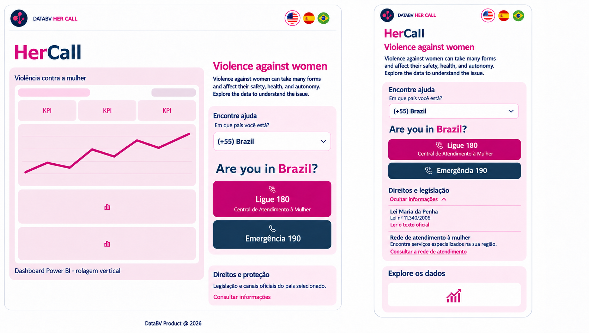

# HerCall

HerCall helps women quickly find emergency and support contacts for the country they are in. Select a country to see local contact numbers, use the call buttons, and consult official information about laws and protections. The project also uses data visualization to help visitors understand violence against women.

## How it works

- **Find help by country.** The country selector updates the contacts and legal resources shown on the page. Call and SMS links open the relevant app on supported devices.
- **Learn about local rights.** The expandable rights section provides links to official legislation and support services for the selected country.
- **Switch languages.** The interface is available in Brazilian Portuguese, English, and Spanish. Changing the language preserves the selected country.
- **Explore the data.** The page has a dedicated Power BI panel alongside the support features.

## MVP status

The current version includes a sample directory for Brazil and Portugal. It loads from data bundled in the HTML. The Power BI panel shows an illustrative preview until an embed URL is configured for the selected language.

## Interface preview

[Desktop with the rights section open](assets/hercall-desktop-direitos-abertos.png) · [Mobile layout](assets/hercall-mobile.png)

## Run locally

Open `index.html` in your browser. Keep the `assets/` and `databv_assets/` folders beside it so both logos load. The site uses HTML, CSS, and JavaScript and runs without a build step.

## Configuration

| Setting in `index.html` | Purpose |
| --- | --- |
| `countriesUrl` | Optional URL for an external JSON directory. The response should match the structure of the bundled `countries-data` block. Leave it empty to use the bundled data. |
| `powerBiEmbedUrls` | Power BI embed URL per language. Use the URL from the iframe's `src` for `pt-BR`, `en`, or `es`. An empty value keeps the preview for that language. |

Cloudflare Pages serves the repository root, with `index.html` as the entry point.

## Credits

A DataBV project by Bia Vasconcelos.

